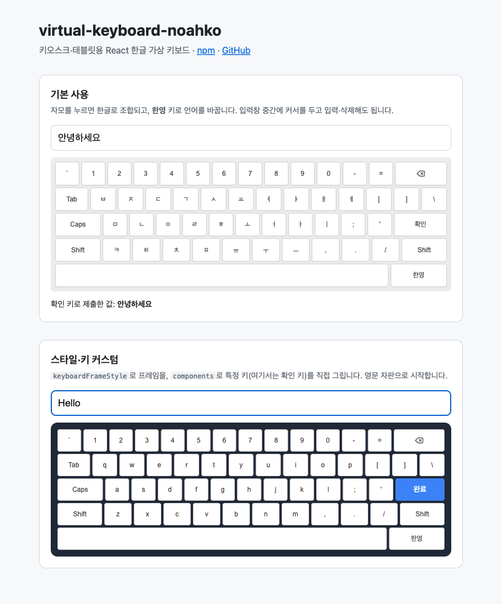

# virtual-keyboard

[](https://www.npmjs.com/package/virtual-keyboard-noahko)
[](./LICENSE)

키오스크·태블릿용 React 한글 가상 키보드 [`virtual-keyboard-noahko`](https://www.npmjs.com/package/virtual-keyboard-noahko)의 저장소입니다.

**[라이브 데모](https://noah8922.github.io/virtual-keyboard/)** · **[사용법(패키지 README)](./packages/virtual-keyboard/README.md)**



## 만든 이유

키즈 실내 놀이시설 매장의 키오스크에서 고객이 한글을 입력해야 했는데, OS 화상 키보드는 한글 입력이 불안정했습니다. 그래서 자모 조합을 직접 처리하는 키보드를 React 컴포넌트로 만들었고, 실제 매장 키오스크에서 쓰고 있습니다. 다른 프로젝트에서도 쓸 수 있게 npm 패키지로 분리했습니다.

## 주요 기능

- 한글 자모 조합과 자모 단위 지우기([hangul-js](https://github.com/e-/Hangul.js) 사용)
- 입력창의 커서 위치에 입력·삭제, 선택 범위 한 번에 지우기
- 한/영 전환, 한 글자 뒤 자동으로 풀리는 Shift
- 프레임 스타일·자판 배열·특정 키 렌더링 커스텀
- 터치 화면 대응(`pointerdown` 입력, 더블 탭 확대 방지)

```tsx
import { useRef, type RefObject } from "react";
import { VirtualKeyboard } from "virtual-keyboard-noahko";

const inputRef = useRef<HTMLInputElement>(null);

<input ref={inputRef} />
<div style={{ height: 240 }}>
  <VirtualKeyboard
    inputRef={inputRef as RefObject<HTMLInputElement>}
    onClickEnter={() => console.log(inputRef.current?.value)}
  />
</div>
```

props와 커스텀 방법은 [패키지 README](./packages/virtual-keyboard/README.md)에 있습니다.

## 저장소 구조

pnpm workspace와 Turborepo로 구성한 모노레포입니다.

```
.
├── apps/
│   └── demo/                  # Vite + React 데모 (GitHub Pages로 배포)
├── packages/
│   ├── virtual-keyboard/      # npm 패키지 virtual-keyboard-noahko (tsup으로 ESM·CJS·타입 빌드)
│   └── typescript-config/     # 공용 tsconfig
└── docs/                      # README용 이미지
```

## 개발

Node.js 18 이상과 pnpm 9가 필요합니다.

```bash
pnpm install
pnpm dev           # 패키지를 빌드한 뒤 데모 개발 서버 실행 (http://localhost:5173)
pnpm build         # 패키지와 데모 빌드
pnpm check-types   # 타입 검사
```

### 배포

- **npm 패키지**: `packages/virtual-keyboard`에서 `version`을 올리고 `npm publish`를 실행합니다. `prepublishOnly`가 타입 검사와 빌드를 먼저 실행합니다.
- **데모**: `main` 브랜치에 push하면 GitHub Actions(`.github/workflows/deploy-demo.yml`)가 GitHub Pages에 배포합니다.

## 라이선스

[MIT](./LICENSE)
